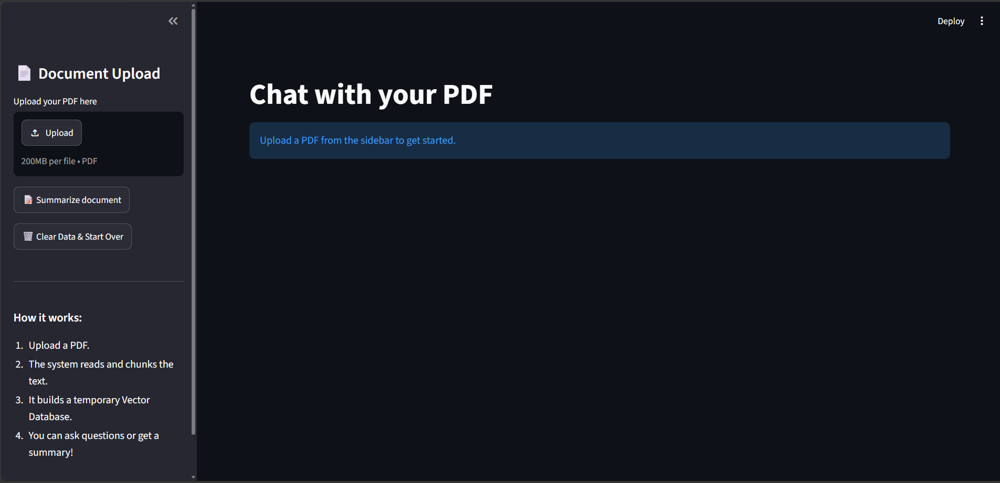

# 📄 Local RAG Document Q&A

A privacy-conscious Retrieval-Augmented Generation (RAG) app that lets you chat with your PDFs. Documents are chunked and embedded **locally** using HuggingFace models, stored in an in-memory ChromaDB vector store, and answered by a fast Groq-hosted LLM.

> **Live demo:** _add your Streamlit link here after deploying_



## ✨ Features

- **Chat with any PDF**: ask questions and get answers grounded in the document
- **Local embeddings**: text is embedded on your machine with `all-MiniLM-L6-v2`, so no external embedding API is used
- **Hallucination-resistant prompting**: the model answers only from retrieved context, otherwise it replies *"I don't know based on the provided document."*
- **Streaming answers**: responses appear word by word
- **Conversation memory**: follow-up questions like *"Explain the second one"* are understood
- **Document summary**: one click to summarize the whole PDF (map-reduce)
- **Source citations**: see which pages each answer came from
- **Chat export**: download the conversation as `.md` or `.txt`
- **Clear & start over**: wipes the temporary vector database

## 🛠️ Tech Stack

| Layer | Tool |
|---|---|
| UI | Streamlit |
| Orchestration | LangChain |
| Embeddings | HuggingFace `sentence-transformers/all-MiniLM-L6-v2` (local) |
| Vector store | ChromaDB (in-memory) |
| LLM | Groq API (`openai/gpt-oss-20b`) |
| PDF parsing | PyPDF |

## ⚙️ How It Works

```
PDF upload → extract text → split into chunks → local embeddings
          → in-memory ChromaDB → retrieve top-4 chunks for a question
          → prompt (context + history + question) → Groq LLM → streamed answer
```

For follow-up questions, the app first rewrites the question into a standalone one using the chat history, then searches with it.

## 🔒 Privacy Note

Embeddings are generated **locally**, and the vector database lives only in memory for the session. However, the retrieved text chunks and your question **are sent to the Groq API** to generate the answer. For fully offline use, the LLM can be swapped for a local model (e.g. via Ollama).

## 🚀 Getting Started

### 1. Clone the repository
```bash
git clone https://github.com/Amansingh279/rag-doc-qa.git
cd rag-doc-qa
```

### 2. Create a virtual environment
```bash
python -m venv venv

# Windows
venv\Scripts\activate

# macOS / Linux
source venv/bin/activate
```

### 3. Install dependencies
```bash
pip install -r requirements.txt
```

### 4. Add your Groq API key
Get a free key from [console.groq.com](https://console.groq.com), then create a file named `.env` in the project folder:
```
GROQ_API_KEY=your_groq_api_key_here
```

### 5. Run the app
```bash
streamlit run app.py
```
Open `http://localhost:8501` in your browser. The first run downloads the embedding model (~90 MB).

## 📁 Project Structure

```
rag-doc-qa/
├── app.py             # Streamlit app: ingestion, retrieval, LLM, UI
├── requirements.txt   # Python dependencies
├── .gitignore         # Keeps .env and venv out of Git
└── README.md
```

## ⚠️ Limitations

- Scanned (image-only) PDFs are not supported yet, because there is no OCR
- Very long PDFs are summarized from evenly sampled sections to stay within free-tier limits
- Answers use only the top retrieved chunks, so very broad questions work better with the **Summarize** button

## 🗺️ Roadmap

- [ ] Multiple PDF upload with per-file citations
- [ ] DOCX / TXT support
- [ ] OCR for scanned PDFs
- [ ] Hybrid search (BM25 + vectors) and reranking
- [ ] Fully local mode with Ollama
- [ ] Persistent vector storage

## 👤 Author

**Aman Singh**
GitHub: [@Amansingh279](https://github.com/Amansingh279)

---
If you find this project useful, consider giving it a ⭐
